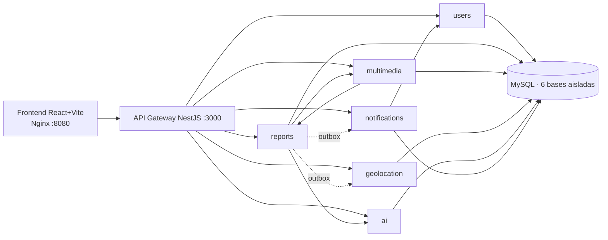

# GreenAlert · Plataforma de Monitoreo Ambiental Ciudadano

Plataforma web para que la ciudadanía de **Mocoa (Putumayo, Colombia)** reporte problemas ambientales —basuras, contaminación hídrica, deforestación, quemas, vertimientos, minería ilegal— con ubicación y fotografías, y para que los funcionarios ambientales los gestionen y hagan seguimiento.

> Proyecto académico de arquitectura de software. **No existe integración oficial** con Corpoamazonia, la Alcaldía de Mocoa, la Gobernación del Putumayo, PNN ni MinAmbiente. La clasificación automática actual es un **servicio de prueba por palabras clave, no un modelo de IA entrenado**.

## Arquitectura



| Componente | Responsabilidad | Base de datos |
|---|---|---|
| `api-gateway` | Enrutamiento, JWT y revocación, rate limiting, CORS, Helmet, Swagger agregado | — |
| `services/users` | Registro, login/logout, perfiles, roles | `greenalert_users` |
| `services/reports` | Reportes, máquina de estados, asignación, historial, outbox | `greenalert_reports` |
| `services/multimedia` | Evidencias: validación por firma binaria, disco + metadatos | `greenalert_multimedia` |
| `services/geolocation` | Cobertura municipal, validación de coordenadas, GeoJSON, consultas por zona | `greenalert_geolocation` |
| `services/ai` | Clasificación sugerida (puerto intercambiable) | `greenalert_ai` |
| `services/notifications` | Cola persistente con reintentos, correo SMTP, historial | `greenalert_notifications` |
| `frontend` | Interfaz ciudadana e institucional responsiva | — |

Tecnologías: NestJS 11 · TypeScript 5.9 · React 19 + Vite 7 · MySQL 8.4 + TypeORM 0.3 · Jest 29 · ESLint 9 · Docker Compose · GitHub Actions · SonarQube (configurado).

## Inicio rápido

```bash
cp .env.example .env        # reemplace todos los valores "cambiar-…"
for s in users reports multimedia geolocation ai notifications api-gateway frontend; do docker compose build $s; done
docker compose up -d
node tests/e2e/smoke.mjs    # verificación extremo a extremo
```

App: http://localhost:8080 · Swagger: http://localhost:3000/api/docs · Correos (dev): http://localhost:8025

## Estado verificado (25-11-2026)

| Control | Resultado |
|---|---|
| TypeScript (`npm run typecheck`) | ✔ sin errores en 8 paquetes |
| ESLint (`npm run lint`, `--max-warnings=0`) | ✔ 0 errores, 0 advertencias |
| Compilación (`npm run build`) | ✔ 8 paquetes |
| Pruebas unitarias | ✔ 278/278 |
| Pruebas de integración (MySQL real) | ✔ 96/96 |
| E2E sobre Docker (incluye fallos y recuperación) | ✔ 21/21 |
| `npm audit --omit=dev` | 0 críticas · 0 altas · 3 moderadas transitivas (TD-07) |
| Imágenes Docker | ✔ 8 construidas, 10 contenedores *healthy* |
| SonarQube (ejecutado localmente) | 0 bugs · 0 vulnerabilidades · 94 code smells · 0 CRITICAL · duplicación 15.3 % · cobertura 73.5 % · 20 hotspots por revisar |
| CI en GitHub | definido, **no ejecutado** (repositorio sin remoto) |

El sistema **no está declarado listo para producción**: ver los requisitos pendientes en `docs/14-despliegue.md` §3.

## Documentación

| # | Documento |
|---|---|
| 01 | [Requisitos funcionales y no funcionales](docs/01-requisitos-funcionales-y-no-funcionales.md) |
| 02 | [Arquitectura general](docs/02-arquitectura-general.md) |
| 03 | [Diagramas de arquitectura](docs/03-diagrama-arquitectura.md) |
| 04 | [Diagrama de microservicios y datos](docs/04-diagrama-microservicios.md) |
| 05 | [Matriz de riesgos arquitectónicos](docs/05-matriz-riesgos-arquitectonicos.md) |
| 06 | [Registro de deuda técnica](docs/06-registro-deuda-tecnica.md) |
| 07 | [Refactorización](docs/07-plan-refactorizacion.md) |
| 08 | [Evaluación ATAM](docs/08-evaluacion-atam.md) |
| 09 | [Evaluación SAAM](docs/09-evaluacion-saam.md) |
| 10 | [Árbol de utilidad](docs/10-arbol-utilidad.md) |
| 11 | [Estrategia y resultados de pruebas](docs/11-estrategia-pruebas.md) |
| 12 | [Informe de calidad de código](docs/12-informe-calidad-codigo.md) |
| 13 | [Seguridad](docs/13-seguridad.md) |
| 14 | [Despliegue](docs/14-despliegue.md) |
| 15 | [Manual de instalación](docs/15-manual-instalacion.md) |
| 16 | [Manual de usuario](docs/16-manual-usuario.md) |
| 17 | [Decisiones arquitectónicas (ADR)](docs/17-decisiones-arquitectonicas.md) |
| — | [Continuidad del trabajo](docs/CONTINUIDAD.md) |

## Estructura

```
├── api-gateway/              # Gateway NestJS
├── services/{users,reports,multimedia,geolocation,ai,notifications}/
│   ├── src/                  # common/ config/ database/ (migraciones) health/ dominio/
│   ├── test/                 # integración (MySQL real + servicio simulado)
│   ├── Dockerfile · jest*.config.js · eslint.config.mjs · package.json
├── frontend/                 # React + Vite + TS, Nginx
├── infrastructure/mysql/     # init (bases y usuarios por servicio), backup
├── infrastructure/monitoring/# guía de observabilidad (pendiente de implementar)
├── tests/e2e/smoke.mjs       # prueba extremo a extremo y de fallos
├── docs/                     # 17 documentos
├── .github/workflows/ci.yml  # pipeline
├── docker-compose.yml · .env.example · sonar-project.properties
└── eslint.base.mjs · tsconfig.base.json   # configuración compartida de herramientas
```
