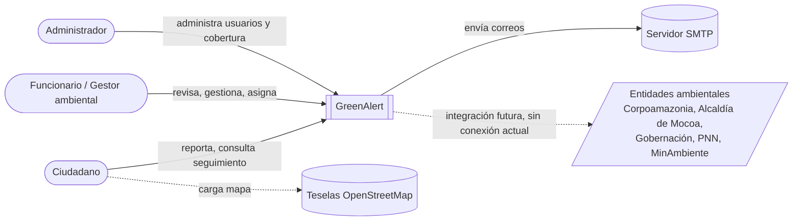
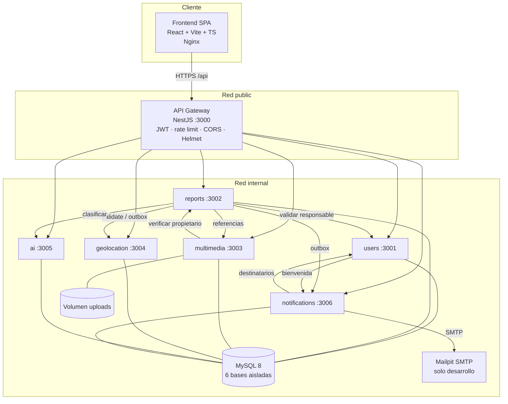
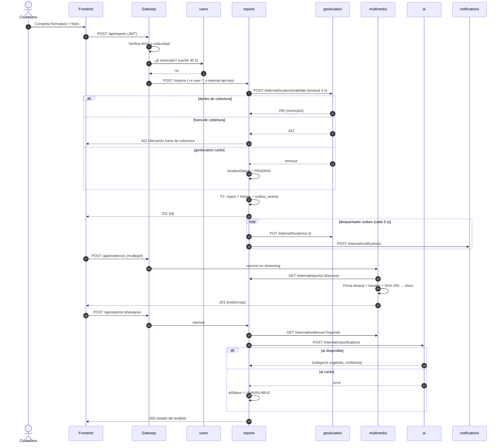
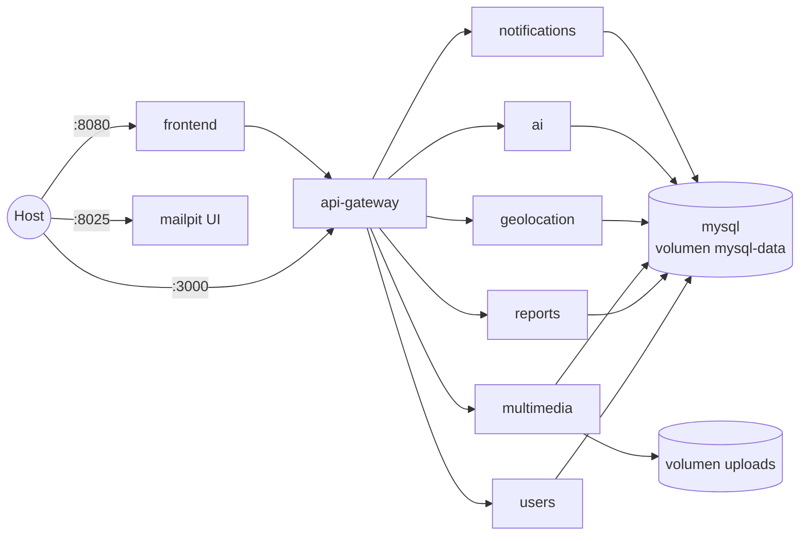

# 03 · Diagramas de arquitectura

## 1. Contexto (C4 nivel 1)

## 2. Contenedores (C4 nivel 2)

## 3. Secuencia: creación de reporte con degradación controlada

## 4. Despliegue local (Docker Compose)

Solo `frontend`, `api-gateway` y la interfaz de Mailpit se publican en el host. MySQL y los microservicios únicamente son accesibles en la red `internal`.
