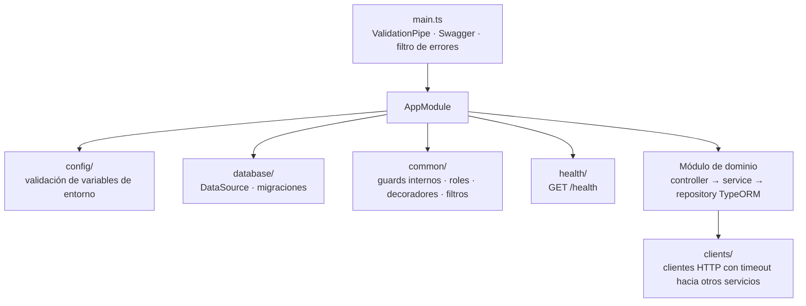
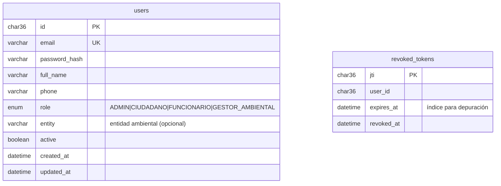
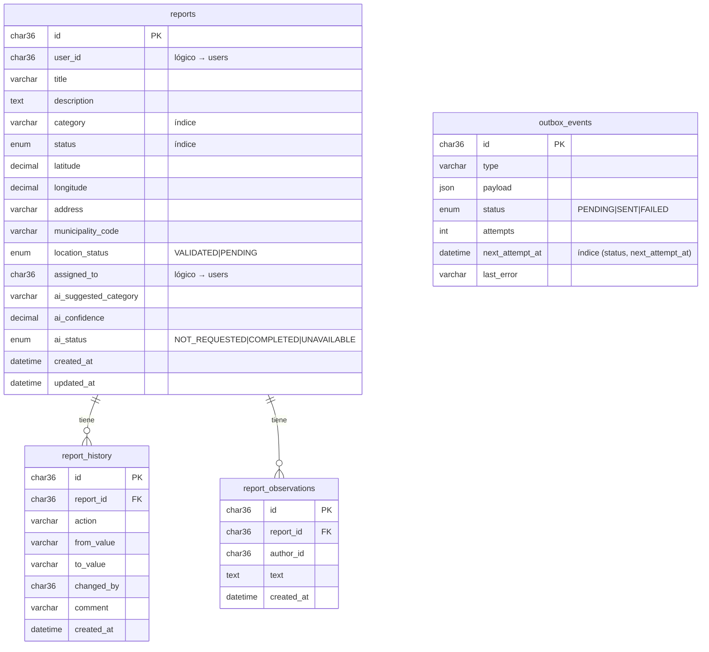
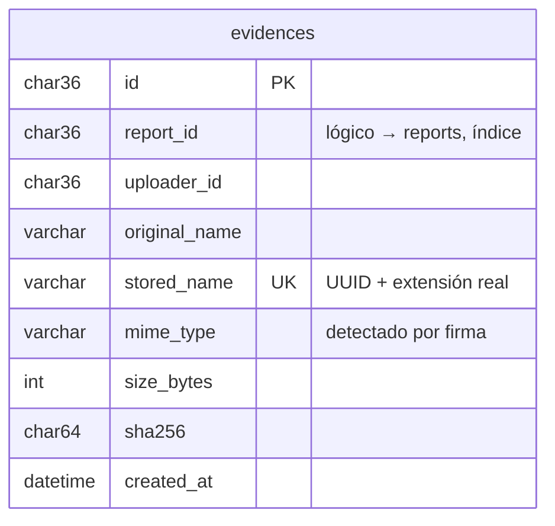
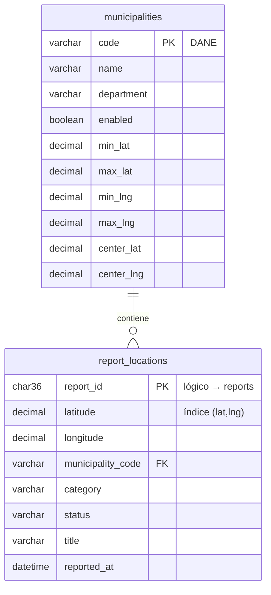
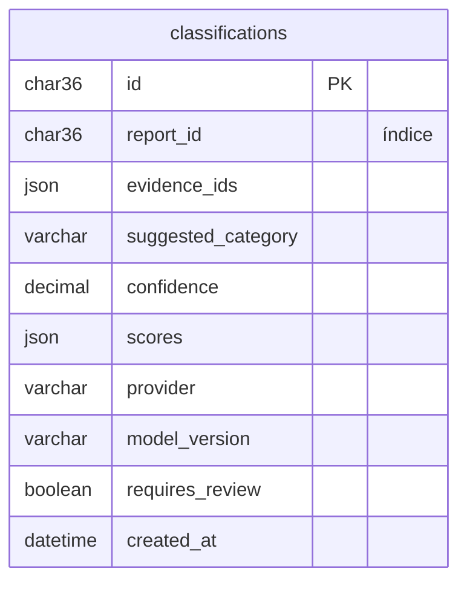
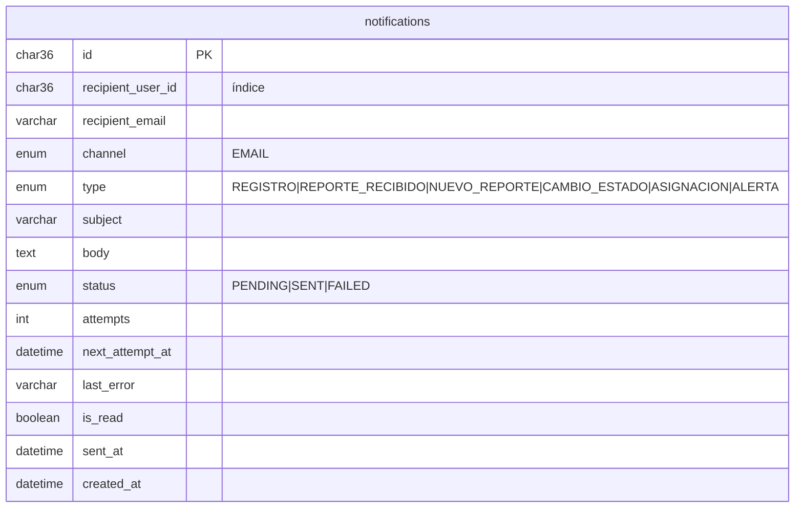

# 04 · Diagrama de microservicios

## 1. Estructura interna común

Todos los servicios siguen la misma organización por capas (cada uno con su propio código; no hay librería compartida en tiempo de ejecución, ver ADR-004):

Capas: **Controller** (HTTP, DTO, Swagger) → **Service** (reglas de negocio, transacciones) → **Repository** (TypeORM) / **Client** (HTTP a otros servicios). Las dependencias externas se inyectan por interfaz (tokens de Nest) para poder sustituirlas en pruebas.

## 2. Endpoints por servicio

| Servicio | Endpoints públicos (vía gateway `/api`) | Endpoints internos (`/internal`, no enrutados) |
|---|---|---|
| users | `POST /auth/register`, `POST /auth/login`, `POST /auth/logout`, `GET /auth/me`, `PATCH /users/me`, `GET /users`, `GET /users/staff`, `PATCH /users/:id/role`, `PATCH /users/:id/status` | `GET /internal/auth/revoked/:jti`, `GET /internal/users/:id`, `GET /internal/users?roles=` |
| reports | `POST /reports`, `GET /reports`, `GET /reports/mine`, `GET /reports/stats`, `GET /reports/:id`, `PATCH /reports/:id`, `PATCH /reports/:id/status`, `PATCH /reports/:id/assignment`, `POST /reports/:id/observations`, `GET /reports/:id/history`, `POST /reports/:id/analysis` | `GET /internal/reports/:id/access` |
| multimedia | `POST /evidences` (multipart), `GET /evidences?reportId=`, `GET /evidences/:id/file`, `DELETE /evidences/:id` | `GET /internal/evidences?reportId=`, `GET /internal/evidences/:id/file` |
| geolocation | `GET /municipalities`, `GET /locations/geojson`, `GET /locations/near`, `GET /locations?municipality=` , `PATCH /municipalities/:code` (ADMIN) | `POST /internal/locations/validate`, `PUT /internal/locations/:reportId` |
| ai | `GET /classifications?reportId=`, `GET /classifications/categories` | `POST /internal/classifications` |
| notifications | `GET /notifications/me`, `PATCH /notifications/:id/read`, `GET /notifications` y `GET /notifications/stats` (ADMIN) | `POST /internal/notifications` |

Todos exponen `GET /health` y Swagger en `/docs` (JSON en `/docs-json`). El gateway agrega los seis documentos en `/api/docs`.

## 3. Modelo de datos por servicio

### users (`greenalert_users`)

### reports (`greenalert_reports`)

### multimedia (`greenalert_multimedia`)

### geolocation (`greenalert_geolocation`)

### ai (`greenalert_ai`)

### notifications (`greenalert_notifications`)

## 4. Matriz de dependencias entre servicios

| ↓ llama a → | users | reports | multimedia | geolocation | ai | notifications |
|---|---|---|---|---|---|---|
| gateway | ● (revocación) | ● | ● | ● | ● | ● |
| users | — | | | | | ○ |
| reports | ● (asignación) | — | ● | ● / ○ | ● | ○ |
| multimedia | | ● | — | | | |
| geolocation | | | | — | | |
| ai | | | | | — | |
| notifications | ● | | | | | — |

● síncrona · ○ asíncrona (outbox / fire-and-forget). No hay ciclos síncronos: `multimedia → reports` y `reports → multimedia` ocurren en flujos distintos (subida vs. análisis) y ninguno espera al otro de forma recursiva.
