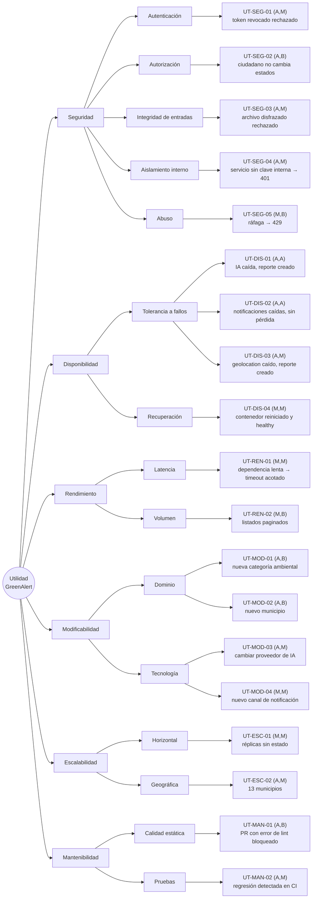

# 10 · Árbol de utilidad

El árbol de utilidad descompone la **utilidad** del sistema en atributos de calidad, subatributos y escenarios concretos. Cada hoja se prioriza con el par ATAM **(Importancia para el negocio, Dificultad/riesgo técnico)** usando la escala cualitativa **A** (alta), **M** (media), **B** (baja). No se usan porcentajes: las prioridades se justifican con los objetivos de negocio (OB) de `08-evaluacion-atam.md`.

Objetivos de negocio usados como justificación:

- **OB-1** Facilitar que cualquier ciudadano de Mocoa reporte un problema ambiental desde el celular.
- **OB-2** Dar a las autoridades información confiable y geolocalizada para priorizar su gestión.
- **OB-3** Proteger los datos personales de los ciudadanos (Ley 1581 de 2012).
- **OB-4** Crecer de Mocoa a todo el Putumayo sin reescribir el sistema.
- **OB-5** Mantener el proyecto evolucionable por un equipo pequeño (académico/institucional).

## 1. Diagrama

## 2. Tabla de escenarios

| ID | Atributo | Subatributo | Escenario | Prioridad (I,D) | Justificación | Métrica | Método de evaluación | ATAM |
|---|---|---|---|---|---|---|---|---|
| UT-SEG-01 | Seguridad | Autenticación | Un usuario cierra sesión y alguien reutiliza su JWT antes de que caduque. | (A,M) | OB-3: una sesión robada no debe seguir activa. Dificultad media por la verificación distribuida. | Solicitud con token revocado → 401 en ≤ TTL de caché (30 s). | Prueba de integración del gateway + prueba manual. | AS-01 |
| UT-SEG-02 | Seguridad | Autorización | Un ciudadano intenta cambiar el estado de un reporte. | (A,B) | OB-2: la gestión es institucional. Resolver con guard de roles es sencillo. | 403 en 100 % de los intentos probados. | Pruebas de integración de `reports`. | AS-02 |
| UT-SEG-03 | Seguridad | Integridad | Se sube un ejecutable renombrado a `.jpg` con `Content-Type: image/jpeg`. | (A,M) | OB-3/OB-2: evita almacenar contenido malicioso. | Rechazo 415; ningún archivo escrito en disco. | Prueba de integración de `multimedia`. | AS-03 |
| UT-SEG-04 | Seguridad | Aislamiento | Un atacante en la red interna llama directamente a `reports` sin clave interna o falsifica `x-user-role`. | (A,M) | OB-3. Requiere disciplina en todos los servicios. | 401 sin clave; el gateway descarta cabeceras `x-user-*` del cliente. | Pruebas de integración de cada servicio + gateway. | AS-04 |
| UT-SEG-05 | Seguridad | Abuso | Un cliente envía más solicitudes por minuto que el límite configurado. | (M,B) | Protege disponibilidad. Middleware estándar. | 429 al superar `RATE_LIMIT_MAX`. | Prueba de integración del gateway. | — |
| UT-DIS-01 | Disponibilidad | Tolerancia | El servicio `ai` no responde mientras un ciudadano registra un reporte y solicita el análisis. | (A,A) | OB-1: el ciudadano nunca debe perder su reporte. Riesgo alto por dependencia en cadena. | Reporte 201; análisis `UNAVAILABLE`; 0 reportes perdidos. | Prueba de fallo con servicio detenido (unitaria + Docker). | AS-05 |
| UT-DIS-02 | Disponibilidad | Tolerancia | `notifications` está caído cuando cambia el estado de un reporte. | (A,A) | OB-2: el ciudadano debe enterarse. Requiere entrega diferida. | Cambio de estado 200; evento entregado tras recuperación (outbox). | Prueba unitaria del despachador + prueba Docker. | AS-06 |
| UT-DIS-03 | Disponibilidad | Tolerancia | `geolocation` está caído al crear un reporte. | (A,M) | OB-1. | 201 con `locationStatus=PENDING`; sincronizado al recuperarse. | Prueba unitaria + Docker. | AS-07 |
| UT-DIS-04 | Disponibilidad | Recuperación | Un contenedor de servicio termina inesperadamente. | (M,M) | OB-2. | El contenedor vuelve a `healthy` sin intervención. | `docker kill` + `docker compose ps`. | AS-08 |
| UT-REN-01 | Rendimiento | Latencia | Una dependencia responde muy lento (> 3 s). | (M,M) | OB-1: la app no se congela. | La llamada se corta al timeout configurado (`HTTP_TIMEOUT_MS`). | Prueba unitaria de cliente HTTP con servidor lento. | AS-09 |
| UT-REN-02 | Rendimiento | Volumen | Un funcionario lista reportes con miles de registros. | (M,B) | OB-2. | Respuesta paginada, `limit ≤ 100`, consulta con índice. | Pruebas de DTO + revisión de migraciones. | — |
| UT-MOD-01 | Modificabilidad | Dominio | Se agrega una nueva categoría ambiental. | (A,B) | OB-4/OB-5. | Nº de servicios modificados (objetivo: ≤ 2). | SAAM S-01. | AS-10 |
| UT-MOD-02 | Modificabilidad | Dominio | Se habilita un nuevo municipio del Putumayo. | (A,B) | OB-4. | 0 cambios de código (solo datos). | SAAM S-02 + endpoint `PATCH /municipalities/:code`. | AS-11 |
| UT-MOD-03 | Modificabilidad | Tecnología | Se reemplaza el clasificador heurístico por un modelo de visión real. | (A,M) | OB-2. | Solo cambia `ai` (nuevo adaptador + variables de entorno). | SAAM S-03. | AS-12 |
| UT-MOD-04 | Modificabilidad | Tecnología | Se agrega un canal SMS/WhatsApp. | (M,M) | OB-1. | Solo cambia `notifications`. | SAAM S-04. | — |
| UT-ESC-01 | Escalabilidad | Horizontal | Se ejecutan 2 réplicas de `reports`. | (M,M) | OB-4. El outbox debe evitar dobles envíos. | Ningún evento entregado dos veces por concurrencia (bloqueo `FOR UPDATE SKIP LOCKED`). | Revisión de diseño ATAM; prueba pendiente. | AS-13 |
| UT-ESC-02 | Escalabilidad | Geográfica | Cobertura ampliada a los 13 municipios del Putumayo. | (A,M) | OB-4. | Consultas por municipio con índice; sin cambios de esquema. | Revisión + SAAM S-02. | AS-11 |
| UT-MAN-01 | Mantenibilidad | Calidad estática | Un PR introduce una promesa no gestionada. | (A,B) | OB-5. | El job `lint` falla y bloquea el merge. | Pipeline CI. | AS-14 |
| UT-MAN-02 | Mantenibilidad | Pruebas | Un cambio rompe la máquina de estados de reportes. | (A,M) | OB-2/OB-5. | El job de pruebas falla. | Pruebas unitarias de `reports` en CI. | AS-14 |

Los escenarios marcados con (A,A) y (A,M) son los que se analizan en profundidad en ATAM (`08-evaluacion-atam.md`). Los resultados reales de su verificación se registran allí y en `11-estrategia-pruebas.md`.
